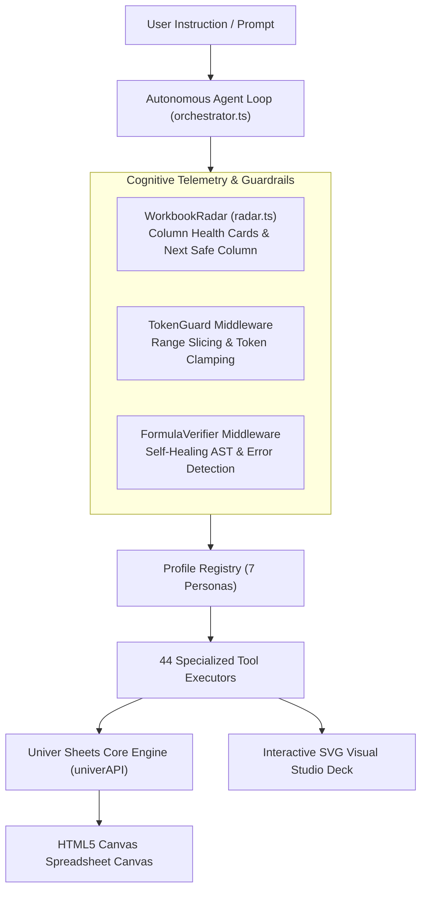
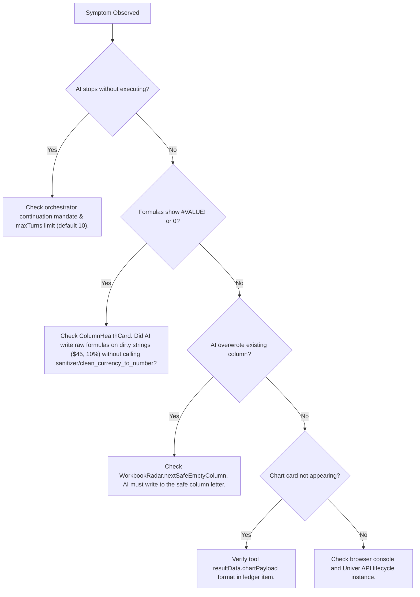

# SORTD: Master Architecture & 44-Tool Technical Reference Manual

---

## Table of Contents
1. **Executive Overview & Design Philosophy**
2. **The Spreadsheet Core: Univer Engine Deep Dive**
   * Versions, Architecture, and DOM/Canvas Rendering
   * State Management, Lifecycle, and APIs (`univerAPI`)
   * Data Model: Workbooks, Worksheets, Ranges, CellData, and Excel I/O
3. **AI Integration Architecture**
   * The 6-Step Autonomous Orchestrator Loop
   * Autonomous Profile Switching & Continuation Mandates
   * The `WorkbookRadar` Telemetry Engine & `ColumnHealthCard`
   * Middleware Guards: `TokenGuard` (Guillotine) & `FormulaVerifier` (Self-Healing)
4. **User Interface & Experience (UI / UX)**
   * Layout, Splitter, and Canvas Integration
   * AI Workbench Sidebar & Collapsible Execution Ledgers
   * Interactive SVG Visual Studio (`VisualChartCard`)
5. **The 7 AI Persona Profiles: Calibration & System Prompts**
   * Core (`core`)
   * Data Sanitizer (`sanitizer`)
   * Formula Pro (`formula_pro`)
   * Spreadsheet Architect (`architect`)
   * Business Analyst (`analyst`)
   * Visualizer & Chart Studio (`visualizer`)
   * Forensic Sheet Auditor (`auditor`)
6. **The Complete 44-Tool Master Catalog (Detailed Specifications)**
   * Core Tools (9 Tools)
   * Sanitizer Tools (6 Tools)
   * Formula Pro Tools (6 Tools)
   * Architect Tools (5 Tools)
   * Analyst Tools (6 Tools)
   * Visualizer Tools (6 Tools)
   * Auditor Tools (6 Tools)
7. **Hardcoded Rules, AI Boundaries & Autonomous Decision Logic**
8. **Forensic Troubleshooting & 60-Second Bottleneck Diagnosis Guide**

---

## 1. Executive Overview & Design Philosophy

**Sortd** is an industrial-grade, client-side AI spreadsheet studio engineered on top of **Univer** and **Next.js 16 (React 19)**. 

Traditional spreadsheet AI assistants suffer from three fatal flaws:
1. **Token Explosions**: Dumping 50,000 raw rows into the prompt context crashes the LLM or exhausts tokens.
2. **Tool Selection Confusion**: Giving a single generic assistant 50 overlapping tools leads to hallucinated functions, wrong tools, or circular loops.
3. **Destructive Blind Overwrites**: The AI writes raw text formulas (`=G2*(1-J2)`) over dirty currency strings (`$45.39`, `10.0%`), overwrites existing data columns, or prematurely stops mid-task after switching context.

Sortd solves this with a **Vectorized, Multi-Persona Architecture**:
* **7 Autonomous Personas**: Non-overlapping operational boundaries.
* **44 Vectorized Tools**: Designed for bulk range operations rather than cell-by-cell loops.
* **Continuous Cognitive Telemetry (`WorkbookRadar`)**: Supplies the LLM with a dense ~250-token mathematical skeleton of the active sheet, including column health, dirty string warnings, and the `nextSafeEmptyColumn`.
* **Zero AI-Slop Design**: Built strictly in zinc, slate, and emerald monochromatic palettes with no garish purple decorations or non-data ink.



---

## 2. The Spreadsheet Core: Univer Engine Deep Dive

### 2.1 Dependencies & Versioning
Sortd is built on Univer version **`^1.2.0`**:
* `@univerjs/presets`: Core preset architecture and theme engine.
* `@univerjs/preset-sheets-core`: Canvas grid, sheet rendering, formula engine, cell formatting, clipboard, and selection services.
* `@univerjs/preset-sheets-core/locales/en-US`: Localization dictionaries.

### 2.2 Rendering Engine & Architecture
Univer operates fundamentally differently from HTML-table-based spreadsheets:
1. **Dual-Layer Architecture**:
   * **Canvas Layer**: High-performance HTML5 Canvas (`<canvas>`) rendering 60 FPS viewport scrolling, gridlines, cell backgrounds, borders, text, and conditional formatting.
   * **DOM Overlay Layer**: Floating HTML overlay used for cell input editors, selection handles, active drag-fill markers, and context menus.
2. **State Management**:
   * Univer utilizes an internal reactive command-mutation pipeline (CommandService, MutationService). Every mutation is recorded in an undo/redo stack.
   * Changes made programmatically via `univerAPI` participate in this lifecycle and can be undone with standard `Ctrl+Z` / `Undo`.

### 2.3 Programmatic API (`univerAPI`)
In Sortd, `univerAPI` is the bridge between the AI executors and the spreadsheet engine:
* `univerAPI.getActiveWorkbook()`: Returns the active `FWorkbook`.
* `workbook.getActiveSheet()` / `workbook.getSheetByName(name)`: Returns the active `FWorksheet`.
* `sheet.getRange(rangeA1 | r, c, numRows, numCols)`: Returns an `FRange` instance.
* `fRange.getValues()` / `fRange.getFormulas()`: Retrieves 2D matrix arrays of evaluated values and raw formulas.
* `fRange.setValues(matrix)` / `fRange.setValue(val)`: Bulk sets evaluated values.
* `fRange.setNumberFormat(mask)`: Applies Excel-compliant number masks (e.g. `_($* #,##0.00_)`).
* `fRange.setBackgroundColor(hex)` / `fRange.setFontColor(hex)`: Updates canvas styles.

---

## 3. AI Integration Architecture

### 3.1 The 6-Step Autonomous Orchestrator Loop (`src/ai/orchestrator.ts`)
When a user submits a prompt, Sortd initiates a client-side execution loop that runs for up to 10 autonomous turns:

```mermaid
sequenceDiagram
    participant User
    participant Loop as Orchestrator Loop
    participant LLM as LLM API (OpenRouter/OpenAI)
    participant Tool as Tool Executor
    participant Univer as Univer Engine

    User->>Loop: "Add NetTotal column and visualize"
    Loop->>Loop: 1. Generate WorkbookRadar (~250 tokens)
    Loop->>Loop: 2. Assemble System Prompt + Active Profile Tools
    Loop->>LLM: 3. Send Messages + Tool Schemas
    LLM-->>Loop: 4. Tool Call: mutate_cells(range='Q1:Q100', formulas)
    Loop->>Tool: 5. Execute Tool (via TokenGuard)
    Tool->>Univer: Mutate cells in Univer sheet
    Tool-->>Loop: Tool Receipt + Formula Verification
    Loop->>Loop: 6. Check Continuation Mandate (Did profile switch? Are there pending steps?)
    Loop->>LLM: Loop turn 2 with Tool Output
    LLM-->>Loop: Final natural language response
    Loop-->>User: Render execution ledger + response + SVG Chart Card
```

### 3.2 Autonomous Profile Switching & Continuation Mandates
To prevent conversational dead-ends when switching profiles:
* When `switch_profile` executes, Sortd dynamically hot-swaps the tool definitions and prompt fragments for the next turn.
* A strict **`[CONTINUATION MANDATE]`** is injected into the context:
  > *"You are now operating under the [NEW_PROFILE] profile. You MUST immediately execute your specialized tools to complete the user's objective without stopping to give conversational acknowledgments."*

### 3.3 The `WorkbookRadar` Telemetry Engine (`src/ai/radar.ts`)
Instead of sending thousands of rows to the LLM, the `WorkbookRadar` compresses the entire sheet into a ~250-token telemetry snapshot:
* **`occupiedBounds`**: Exact active dimensions (e.g., `A1:P150`).
* **`nextSafeEmptyColumn`**: The exact column letter immediately following occupied data (e.g., `Q`), preventing destructive column overwrites.
* **`columnHealthCards`**: Deep column-by-column statistics:
  * Type census (counts of numbers, dates, currency strings, percentage strings, booleans, formulas, nulls).
  * Outlier detection & top frequent values.
  * **Hazard Alerts**: Flags if a column contains text numbers formatted like `$45.39` or `10.0%`, warning the AI that raw math formulas will fail without cleaning.

### 3.4 Middleware Guards
1. **`TokenGuard` (`src/ai/middleware/tokenGuard.ts`)**:
   * Guillotine range clamp: If a tool requests inspection of `A1:Z5000`, the TokenGuard extracts the first 15 rows and last 5 rows, summarizes the middle rows into mathematical aggregates ($\min, \max, \text{nullCount}$), and protects the LLM context window from overflowing.
2. **`FormulaVerifier` (`src/ai/middleware/formulaVerifier.ts`)**:
   * Post-mutation scanner: Automatically runs after any mutation. If `#REF!`, `#DIV/0!`, or syntax errors are detected, it returns an explicit warning receipt to the AI so it can self-heal on the next turn.

---

## 4. User Interface & Experience (UI / UX)

### 4.1 AI Workbench Sidebar (`src/components/AIWorkbenchSidebar.tsx`)
* **Collapsible & Resizable**: A draggable 410px sidebar docked to the right of the spreadsheet grid.
* **Profile Status Pill**: Displays the currently active persona (`CORE`, `SANITIZE`, `FORMULA`, `ARCHITECT`, `ANALYST`, `VIZ`, `AUDIT`) with distinct color badging.
* **Radar Telemetry Drawer**: Collapsible telemetry pill showing active bounds and occupied rows/cols.
* **BYOK Support**: Bring-Your-Own-Key modal supporting OpenRouter (`google/gemini-2.5-flash`, `anthropic/claude-3.5-sonnet`, `openai/gpt-4o`) and direct OpenAI keys.

### 4.2 Collapsible Execution Ledgers
Every tool execution generates a 28px thin ledger row:
* Status LED: Green (Success), Yellow (Warning / Formula Errors), Red (Error).
* Duration: Recorded in milliseconds ($\Delta t$).
* Tool name and summary text.
* Expandable JSON inspector allowing users to audit the exact input arguments and raw receipt data returned by Univer.

### 4.3 Interactive SVG Visual Studio (`src/components/VisualChartCard.tsx`)
* Renders 15 chart types using pure, responsive SVG (zero external charting bloat).
* Features interactive floating tooltips on hover.
* Single-click **Download SVG** button for exporting charts into slide decks.
* Full-screen modal expansion.

---

## 5. The 7 AI Persona Profiles: Calibration & System Prompts

| Profile ID | Badge | Theme Color | Primary Purpose |
| :--- | :---: | :---: | :--- |
| **`core`** | `CORE` | `#3b82f6` (Blue) | Universal sheet coordination, range inspection, cell mutations, profile routing. |
| **`sanitizer`** | `SANITIZE` | `#f59e0b` (Amber) | Data hygiene, ISO-8601 parsing, dirty string stripping, deduplication, unpivoting. |
| **`formula_pro`** | `FORMULA` | `#8b5cf6` (Purple) | Dynamic arrays, `XLOOKUP` matrices, multi-criteria rollups, financial math. |
| **`architect`** | `ARCHITECT` | `#06b6d4` (Cyan) | Number formatting (Accounting, Currency), zebra hierarchies, KPI blocks, themes. |
| **`analyst`** | `ANALYST` | `#6366f1` (Indigo) | Multi-level group-bys, 2D crosstab pivots, MoM trends, Pareto 80/20, what-if tables. |
| **`visualizer`** | `VIZ` | `#10b981` (Emerald) | 15 SVG chart types, AI chart recommendation, heatmaps, data bars, sparklines. |
| **`auditor`** | `AUDIT` | `#ef4444` (Red) | Formula error isolation, precedent/dependent trees, double-entry cross-footing, Benford QA. |

---

## 6. The Complete 44-Tool Master Catalog

### 6.1 Profile: `core` (9 Universal Tools)

#### 1. `inspect_range`
* **Purpose**: Inspects cell values, evaluated results, formulas, and data types across a range.
* **Parameters**: `range` (string, e.g. `'A1:D20'`), `sheetName` (optional string), `includeFormulas` (boolean, default true).
* **Internal Logic**: Uses `TokenGuard` to clamp large ranges to first 15 and last 5 rows. Returns 2D value matrix and formula matrix.

#### 2. `transform_range`
* **Purpose**: Vectorized in-place data transformations across an entire column or block without looping.
* **Parameters**: `range` (string), `operation` (`'trim' | 'uppercase' | 'lowercase' | 'titlecase' | 'clean_number' | 'format_date'`), `sheetName` (optional).
* **Internal Logic**: Fetches matrix, executes fast JS string/numeric regex transformations, and pushes bulk updates in a single `setValues` call.

#### 3. `search_workbook`
* **Purpose**: Global full-text search across all worksheets.
* **Parameters**: `query` (string), `matchCase` (boolean), `exactMatch` (boolean).
* **Internal Logic**: Iterates all sheets via `workbook.getSheets()`, scans cell text, and returns coordinates of all occurrences.

#### 4. `profile_columns`
* **Purpose**: Statistical and structural profiling of columns.
* **Parameters**: `range` (optional string).
* **Internal Logic**: Evaluates null percentages, unique values, dominant types, and min/max numbers.

#### 5. `mutate_cells`
* **Purpose**: Writes formulas, numbers, or text into a specified range.
* **Parameters**: `range` (string), `values` (optional 2D array), `formulas` (optional 2D array of formulas), `sheetName` (optional).
* **Internal Logic**: Applies updates via Univer API, immediately triggers `FormulaVerifier`, and returns verification receipt.

#### 6. `modify_structure`
* **Purpose**: Structural sheet operations: insert/delete rows or columns, resize columns, clear ranges.
* **Parameters**: `action` (`'insert_rows' | 'insert_cols' | 'delete_rows' | 'delete_cols' | 'set_col_width' | 'clear'`), `index` (number), `count` (number), `size` (number).
* **Internal Logic**: Calls Univer structural commands.

#### 7. `style_range`
* **Purpose**: Core cell styling (bold, italic, font size, background color, text color, alignment).
* **Parameters**: `range` (string), `bold` (boolean), `italic` (boolean), `fontSize` (number), `backgroundColor` (hex), `fontColor` (hex), `horizontalAlign` (`'left' | 'center' | 'right'`).
* **Internal Logic**: Updates canvas styling properties on the target `FRange`.

#### 8. `switch_profile`
* **Purpose**: Transfers execution authority to another specialized persona profile.
* **Parameters**: `targetProfile` (`'core' | 'sanitizer' | 'formula_pro' | 'architect' | 'analyst' | 'visualizer' | 'auditor'`), `reason` (string).
* **Internal Logic**: Hot-swaps the active tool registry and injects the `[CONTINUATION MANDATE]` into the orchestrator loop.

#### 9. `switch_sheet`
* **Purpose**: Switches active view to another worksheet or creates a new sheet tab.
* **Parameters**: `sheetName` (string), `createIfMissing` (boolean).
* **Internal Logic**: Resolves sheet by name or creates a new sheet via `workbook.create(name, rows, cols)`.

---

### 6.2 Profile: `sanitizer` (6 Tools)

#### 10. `standardize_dates`
* **Purpose**: Detects mixed date formats (`MM/DD/YYYY`, `DD/MM/YYYY`, `YYYY-MM-DD`, `08-Apr-23`) and converts them to standardized ISO-8601 (`YYYY-MM-DD`).
* **Parameters**: `column` (string), `preferredFormat` (`'YYYY-MM-DD' | 'DD/MM/YYYY' | 'MM/DD/YYYY'`), `sheetName` (optional).
* **Internal Logic**: Employs heuristic date parsing to resolve ambiguous days/months, writes clean strings, and sets the number format mask.

#### 11. `synthesize_columns`
* **Purpose**: Merges, cleans, or computes new clean columns from dirty existing columns using arithmetic or string templates.
* **Parameters**: `sourceColumns` (string[]), `targetColumn` (string), `operation` (`'clean_currency_to_number' | 'clean_percentage_to_decimal' | 'concatenate' | 'math_expression'`), `expression` (optional string), `headerTitle` (string).
* **Internal Logic**: Strips `$`, commas, `%`, parses clean float values, and writes pristine numeric values into the target column.

#### 12. `split_column`
* **Purpose**: Splits a delimited text column (e.g. `"First Last"`, `"City, State"`) into multiple destination columns.
* **Parameters**: `sourceColumn` (string), `delimiter` (string), `targetStartColumn` (string), `headerTitles` (string[]).
* **Internal Logic**: Splits strings by delimiter or regex, trims components, and writes values into consecutive columns.

#### 13. `deduplicate_dataset`
* **Purpose**: Removes duplicate rows based on primary key or all column values.
* **Parameters**: `range` (string), `keyColumns` (string[]), `keepFirst` (boolean).
* **Internal Logic**: Hashes row contents, filters duplicate rows, and rewrites the clean compacted range.

#### 14. `impute_data`
* **Purpose**: Fills missing/blank cells using statistical imputation (mean, median, mode, forward-fill, constant).
* **Parameters**: `range` (string), `strategy` (`'mean' | 'median' | 'mode' | 'forward_fill' | 'constant'`), `fillValue` (optional).
* **Internal Logic**: Computes imputation statistics across valid numbers in the column and fills only blank/null cells.

#### 15. `reshape_dataset`
* **Purpose**: Reshapes data between wide and long formats (Unpivot / Melt).
* **Parameters**: `sourceRange` (string), `idColumns` (string[]), `valueColumns` (string[]), `targetSheetName` (string).
* **Internal Logic**: Transforms wide matrix tables (e.g. Month columns) into a normalized long table (`[ID, Variable, Value]`).

---

### 6.3 Profile: `formula_pro` (6 Tools)

#### 16. `build_lookup`
* **Purpose**: Constructs high-precision `XLOOKUP`, `INDEX-MATCH`, or `VLOOKUP` formulas.
* **Parameters**: `targetRange` (string), `lookupValueColumn` (string), `lookupVector` (string), `resultVector` (string), `ifNotFound` (optional string), `formulaType` (`'XLOOKUP' | 'INDEX_MATCH' | 'VLOOKUP'`).
* **Internal Logic**: Generates syntactically correct lookup formulas for each row in the target range.

#### 17. `compose_aggregation`
* **Purpose**: Builds multi-criteria `SUMIFS`, `COUNTIFS`, `AVERAGEIFS` or `SUMPRODUCT` formulas.
* **Parameters**: `targetCell` (string), `aggFunction` (`'SUMIFS' | 'COUNTIFS' | 'AVERAGEIFS'`), `sumRange` (string), `criteria` (array of `{ range, condition }`).
* **Internal Logic**: Assembles validated Excel formulas and verifies evaluation.

#### 18. `generate_financial_model`
* **Purpose**: Generates complete loan amortization schedules, DCF models, or depreciation tables.
* **Parameters**: `modelType` (`'amortization' | 'dcf' | 'cagr'`), `principal` (number), `rate` (number), `periods` (number), `targetSheet` (optional).
* **Internal Logic**: Populates complete multi-row financial schedules using `PMT`, `PPMT`, `IPMT` formulas with formatted headers.

#### 19. `cascade_dynamic_arrays`
* **Purpose**: Implements dynamic array formulas (`FILTER`, `UNIQUE`, `SORT`, `SEQUENCE`).
* **Parameters**: `startCell` (string), `sourceRange` (string), `formulaType` (`'UNIQUE' | 'FILTER' | 'SORT' | 'SEQUENCE'`), `filterCondition` (optional string).
* **Internal Logic**: Writes modern dynamic array formulas that spill cleanly into adjacent cells.

#### 20. `matrix_math_engine`
* **Purpose**: Solves linear algebra systems, covariance matrices, and weighted portfolios using `MMULT`, `TRANSPOSE`.
* **Parameters**: `matrixA` (string), `matrixB` (string), `operation` (`'MMULT' | 'TRANSPOSE'`), `targetCell` (string).
* **Internal Logic**: Verifies dimensional compatibility and injects matrix formulas.

#### 21. `validate_and_heal_formulas`
* **Purpose**: Scans formulas for syntax errors, missing parentheses, or wrong delimiters, and heals them.
* **Parameters**: `range` (string).
* **Internal Logic**: Uses tokenizer AST checks to detect formula errors and rewrite valid syntax.

---

### 6.4 Profile: `architect` (5 Tools)

#### 22. `format_numbers`
* **Purpose**: Applies standardized financial number masks across ranges.
* **Parameters**: `rangeA1` (string), `formatType` (`'currency' | 'currency_round' | 'percentage' | 'accounting' | 'integer' | 'compact_thousands' | 'compact_millions' | 'date_iso'`), `customPattern` (optional).
* **Internal Logic**: Directly applies Excel number formatting strings (e.g. `_($* #,##0.00_);_($* (#,##0.00);_($* "-"??_);_(@_)`).

#### 23. `style_table_hierarchy`
* **Purpose**: Formats entire tabular blocks with professional visual hierarchies (headers, alternating zebra striping, total rows, auto-fit widths).
* **Parameters**: `rangeA1` (string), `theme` (`'slate_monochrome' | 'emerald_capital' | 'midnight_navy' | 'charcoal_ledger'`), `zebraStriping` (boolean), `hasTotalRow` (boolean).
* **Internal Logic**: Calculates table boundaries, styles headers with 30px row height and bold white text, stripes even/odd data rows, and styles the total row with top/bottom accounting borders.

#### 24. `create_kpi_card_block`
* **Purpose**: Generates an executive 3-card or 4-card KPI summary tile block at the top of a sheet.
* **Parameters**: `cards` (array of `{ title, formulaOrValue, formatType, deltaText, deltaPositive }`), `startCell` (string), `theme` (optional).
* **Internal Logic**: Merges cells, creates card background fills with subtle borders, styles large 18pt KPI metrics, and adds micro delta badges.

#### 25. `apply_executive_theme`
* **Purpose**: Applies a global visual palette across the entire workbook.
* **Parameters**: `theme` (`'slate_monochrome' | 'emerald_capital' | 'midnight_navy' | 'charcoal_ledger'`).
* **Internal Logic**: Sets default workbook font, standardizes gridlines, and configures theme tokens.

#### 26. `scaffold_dashboard_layout`
* **Purpose**: Scaffolds a complete executive dashboard sheet layout (Header title, KPI band, Main Chart Area, Summary Grid).
* **Parameters**: `dashboardTitle` (string), `sheetName` (string).
* **Internal Logic**: Creates a new sheet, structures 4 distinct zones, and sets proper column widths and row heights.

---

### 6.5 Profile: `analyst` (6 Tools)

#### 27. `aggregate_multilevel_groupby`
* **Purpose**: Multidimensional hierarchical grouping across 1 or more dimensions (e.g. Region $\times$ Category) with multiple metrics (sum, count, unique_count, avg, min, max) and automatic grand totals.
* **Parameters**: `groupByColumns` (string[]), `metrics` (array of `{ column, agg, alias }`), `sortByMetricIndex` (optional number), `sortDirection` (`'asc' | 'desc'`), `targetSheetName` (optional).
* **Internal Logic**: Groups data using JavaScript Maps, computes aggregations, sorts rows, calculates executive grand totals, and writes out a formatted summary table.

#### 28. `generate_crosstab_pivot`
* **Purpose**: Builds 2D matrix pivot grids (Row Dimension $\times$ Column Dimension $\times$ Metric) with row totals, column totals, and optional % shares.
* **Parameters**: `rowDimension` (string), `colDimension` (string), `metricColumn` (string), `agg` (`'sum' | 'count' | 'average'`), `showPercentages` (optional `'none' | 'percent_of_total'`), `targetSheetName` (optional).
* **Internal Logic**: Extracts unique row and column keys, constructs a 2D cross-tab matrix, appends row and column sums, and writes the resulting pivot grid.

#### 29. `temporal_trend_analyzer`
* **Purpose**: Time-series aggregation into chronological periods (Month, Quarter, Year), computing period-over-period growth rates (MoM %, YoY %) and moving averages.
* **Parameters**: `dateColumn` (string), `metricColumn` (string), `period` (`'monthly' | 'quarterly' | 'yearly'`), `agg` (`'sum' | 'average'`), `calculateGrowth` (boolean), `targetSheetName` (optional).
* **Internal Logic**: Parses dates, buckets into `YYYY-MM` or `YYYY-Q#`, sorts chronologically, calculates $\Delta\% = \frac{V_t - V_{t-1}}{V_{t-1}}$, and writes trend tables.

#### 30. `pareto_and_segmentation`
* **Purpose**: Performs 80/20 Pareto analysis and customer/product tier classification (Platinum, Gold, Silver, Bronze).
* **Parameters**: `entityColumn` (string), `metricColumn` (string), `analysisType` (`'pareto_80_20' | 'customer_tiers'`), `targetSheetName` (optional).
* **Internal Logic**: Sorts entities descending by metric, computes cumulative totals and cumulative percentage shares, assigns classifications, and outputs the sorted distribution.

#### 31. `statistical_deep_dive`
* **Purpose**: Rigorous descriptive statistics (Mean, Median, StdDev, Skewness, Kurtosis, P10, P25, P75, P90, P99), IQR outlier identification, and pairwise Pearson correlation matrix.
* **Parameters**: `columns` (string[]), `analysisType` (`'descriptive_summary' | 'correlation_matrix' | 'outlier_report'`), `targetSheetName` (optional).
* **Internal Logic**: Computes mathematical moment statistics, covariance, and correlation matrices $r = \frac{\sum (x-\bar{x})(y-\bar{y})}{\sqrt{\sum(x-\bar{x})^2 \sum(y-\bar{y})^2}}$.

#### 32. `what_if_scenario_modeler`
* **Purpose**: Sensitivity analysis and scenario modeling (Base, Optimistic, Pessimistic) testing revenue, cost, or discount shocks.
* **Parameters**: `baselineValue` (number), `scenarios` (array of `{ name, driverDeltas: { priceDeltaPct, volumeDeltaPct, costDeltaPct } }`), `targetSheetName` (optional).
* **Internal Logic**: Computes comparative P&L variance projections across all shock scenarios.

---

### 6.6 Profile: `visualizer` (6 Tools)

#### 33. `generate_chart`
* **Purpose**: Flagship interactive charting engine supporting 15 chart types with an autonomous AI recommendation engine.
* **Parameters**: `range` (string), `chartType` (`'auto' | 'column' | 'bar' | 'line' | 'area' | 'donut' | 'combo_dual_axis' | 'waterfall' | 'scatter' | 'bubble' | 'pareto' | 'histogram' | 'box_plot' | 'funnel' | 'radar' | 'treemap'`), `xAxisColumn` (optional string), `yAxisColumns` (optional string[]), `secondaryYAxisColumn` (optional string), `title` (optional string), `palette` (`'slate_emerald' | 'monochrome_zinc' | 'ocean_blue' | 'diverging_bipolar'`).
* **Internal Logic**:
  * If `chartType === 'auto'`, analyzes date vs numeric vs categorical column types and cardinality to select the optimal visualization.
  * Extracts categories and numeric series data.
  * Returns a structured `ChartPayload` rendered as an interactive SVG chart in the conversation ledger and visual studio dock.

#### 34. `apply_color_scale`
* **Purpose**: Continuous, quantile, or diverging color heatmaps directly on spreadsheet cells with WCAG font contrast balancing.
* **Parameters**: `range` (string), `scaleType` (`'2_color' | '3_color' | 'quantile_percentile' | 'diverging_zero_centered'`), `palette` (`'emerald_to_zinc' | 'slate_neutral' | 'red_amber_emerald' | 'blue_to_slate'`), `clampOutliers` (boolean, default true).
* **Internal Logic**: Winsorizes bounds at P05/P95 if enabled, calculates RGB color interpolations, computes luminance $L = 0.2126R + 0.7152G + 0.0722B$, and automatically sets text to pure white if $L < 0.45$.

#### 35. `add_data_bars`
* **Purpose**: In-cell horizontal proportional data bars with zero-axis splitting for negative numbers.
* **Parameters**: `range` (string), `barColor` (hex, default `#10b981`), `negativeBarColor` (hex, default `#ef4444`), `axisPosition` (`'automatic' | 'cell_midpoint'`).
* **Internal Logic**: Normalizes values against $\max(|x|)$ and applies soft proportional background fills to visually represent magnitudes directly inside cells.

#### 36. `create_threshold_rule`
* **Purpose**: Conditional formatting rules applying executive soft badges based on conditions or percentiles.
* **Parameters**: `range` (string), `condition` (`'greater_than' | 'less_than' | 'between' | 'equal_to' | 'contains_text' | 'top_n_percent' | 'below_average'`), `thresholdValue` (any), `badgeStyle` (`'soft_alert_red' | 'soft_warning_amber' | 'soft_success_emerald' | 'subtle_highlight_zinc'`).
* **Internal Logic**: Evaluates conditions against cell numbers or text, applying subtle pill badge backgrounds (e.g. `#fef2f2` bg with `#b91c1c` text for soft red).

#### 37. `render_sparkline_strip`
* **Purpose**: Injects compact Unicode micro-sparklines (` ▂▃▄▅▆▇█`) across multi-period columns (e.g. Jan..Dec) into a target KPI column.
* **Parameters**: `sourceRange` (string), `targetColumn` (string), `sparklineType` (`'bars' | 'blocks' | 'dots'`), `headerTitle` (string).
* **Internal Logic**: Evaluates row-by-row numeric arrays, normalizes values across 8 glyph steps, and writes the string directly into the target column.

#### 38. `clear_visual_formatting`
* **Purpose**: Granular removal of heatmaps, data bars, or badges without removing formulas or data.
* **Parameters**: `range` (string), `target` (`'all' | 'color_scales' | 'threshold_rules' | 'data_bars'`).
* **Internal Logic**: Resets cell backgrounds to null / transparent and restores font colors to default.

---

### 6.7 Profile: `auditor` (6 Tools)

#### 39. `audit_formula_integrity`
* **Purpose**: Comprehensive formula health scan across the workbook or range.
* **Parameters**: `range` (optional string), `flagHardcodedConstants` (boolean, default true), `sheetName` (optional).
* **Internal Logic**: Isolates `#REF!`, `#DIV/0!`, `#VALUE!`, `#NAME?`, `#N/A`, `#NUM!`, `#NULL!`, flags self-referencing circular dependency hazards, and pinpoints bad-practice hardcoded constants (e.g. `*1.15`, `/12`) inside formulas.

#### 40. `trace_dependencies`
* **Purpose**: Dependency tree mapping for any cell coordinate.
* **Parameters**: `cellCoordinate` (string), `direction` (`'precedents' | 'dependents' | 'both'`), `sheetName` (optional).
* **Internal Logic**: Parses formula cell references for upstream precedents, scans the active sheet for downstream formulas referencing the cell, and flags unreferenced orphan inputs.

#### 41. `reconcile_accounting_crossfoot`
* **Purpose**: High-precision accounting tie-out and cross-footing verification.
* **Parameters**: `mode` (`'cross_foot' | 'debit_credit' | 'balance_sheet_identity'`), `range` (optional string), `debitColumn` (optional string), `creditColumn` (optional string), `tolerance` (number, default 0.01).
* **Internal Logic**:
  * Cross-foot: Verifies that horizontal sum of column totals equals vertical sum of row totals.
  * Debits/Credits: Verifies $\sum \text{Debits} == \sum \text{Credits}$ within tolerance.
  * Pinpoints exact discrepancy down to the cent.

#### 42. `scan_formula_continuity`
* **Purpose**: Audits formula ranges for structural continuity gaps and formula mutations.
* **Parameters**: `range` (string), `sheetName` (optional).
* **Internal Logic**: Detects omitted bounds in `SUM`/`AVERAGE` ranges (e.g. `SUM` ends at row 18 while table data extends to row 25), and flags cells that break the columnar relative-reference pattern.

#### 43. `detect_forensic_anomalies`
* **Purpose**: Forensic outlier, statistical spike, and fraud detection.
* **Parameters**: `column` (string), `checkBenfordLaw` (boolean, default true), `strictlyNonNegative` (boolean), `sheetName` (optional).
* **Internal Logic**:
  * Benford's Law: Evaluates observed first-digit frequency against logarithmic theory, computing Mean Absolute Deviation (MAD) to detect synthetic/manipulated numbers.
  * $3.5\sigma$ Spikes: Flags numbers $>3.5$ standard deviations from the mean.
  * Flags forbidden negative values in non-negative columns.

#### 44. `inspect_hidden_and_external`
* **Purpose**: Workbook structure and governance check.
* **Parameters**: `sheetName` (optional).
* **Internal Logic**: Audits all sheets in the workbook for hidden calculation tabs, hidden rows, hidden columns, and external workbook links (`[ExternalBook.xlsx]`).

---

## 7. Hardcoded Rules, AI Boundaries & Autonomous Decision Logic

### What is Hardcoded vs AI-Decided?

| System Layer | Hardcoded / Deterministic Guardrails | AI Autonomous Decision Scope |
| :--- | :--- | :--- |
| **Tool Availability** | Only Core tools + Active Profile tools are mounted. Profiles cannot execute tools outside their domain without calling `switch_profile`. | AI autonomously decides when to switch profiles and which tools to sequence. |
| **Token Safety** | `TokenGuard` strictly truncates raw range reads $>20$ rows to first 15 + last 5 rows. | AI decides how to filter, slice, or aggregate data before reading. |
| **Error Trapping** | `FormulaVerifier` runs automatically after any mutation, scanning for `#REF!` / `#DIV/0!`. | AI reads the verification receipt and decides how to heal or fix the formula. |
| **Palette Tokens** | Monochromatic palettes (slate, zinc, emerald) are strictly enforced in CSS/SVG to eliminate purple AI slop. | AI chooses which theme or chart type to apply from the allowed executive set. |
| **Chart Recommendation** | Mathematical heuristic rules (temporal $\rightarrow$ line, $>7$ categories $\rightarrow$ bar, 2-5 categories $\rightarrow$ donut). | User or AI can override with an explicit `chartType` at any time. |
| **Handoff Continuation** | Orchestrator injects `[CONTINUATION MANDATE]` upon `switch_profile` to enforce immediate action. | The newly activated profile autonomously formulates the tool arguments. |

---

## 8. Forensic Troubleshooting & 60-Second Bottleneck Diagnosis Guide

If an issue ever occurs in Sortd, use this diagnostic decision matrix:



### Quick Diagnostic Cheat Sheet:
1. **"The formula calculated to 0 or `#VALUE!`"**:
   * *Root Cause*: The source column contains formatted strings (e.g. `"$45.39"` or `"10%"`). Univer canvas parses them as text strings, so raw multiplication fails.
   * *Remedy*: Call `sanitizer.synthesize_columns` with `clean_currency_to_number` first, or use `formula_pro.validate_and_heal_formulas`.
2. **"The AI says it completed the task, but nothing changed in the sheet"**:
   * *Root Cause*: The AI operated on a new sheet tab or misidentified the target range.
   * *Remedy*: Inspect the execution ledger's `Input Arguments` and `Receipt` JSON drawers to see the exact sheet and range coordinates touched.
3. **"Canvas grid disappears after route navigation"**:
   * *Root Cause*: Univer lifecycle disposal race condition.
   * *Remedy*: Check `SpreadsheetWorkspace.tsx` cleanup ref. Univer requires disposing the previous instance before mounting to a re-rendered DOM container.
4. **"Large ranges cause chat lag"**:
   * *Root Cause*: `TokenGuard` bypass or excessive cell-by-cell loops.
   * *Remedy*: Verify `TokenGuard.clampRange` is wrapping range reads. Always prefer bulk vectorized tools (`transform_range`, `mutate_cells`) over single-cell mutations.
