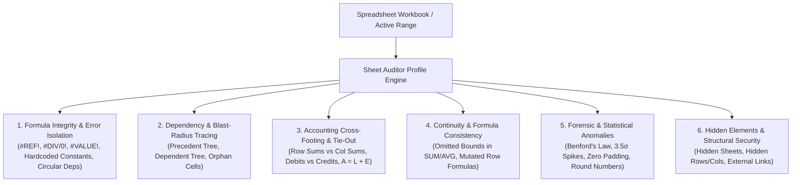

# Sheet Auditor Profile & Forensic Accounting Verification Specification

## 1. Executive Overview
The **Sheet Auditor Profile** (`auditor`) is the 7th and final persona profile in Sortd. It provides institutional-grade spreadsheet audit, forensic accounting validation, formula dependency tracing, and mathematical sanity-checking modeled after Big-4 (PwC, EY, Deloitte, KPMG) spreadsheet auditing standards, FAST modeling standard, and ICAEW 20 principles.

---

## 2. Core Operational Domains of the Auditor

---

## 3. Tool Specifications

### Tool 1: `audit_formula_integrity`
* **Purpose**: Comprehensive formula health scan across the workbook or range.
* **Capabilities**:
  - Identifies coordinates and details for `#REF!`, `#DIV/0!`, `#VALUE!`, `#NAME?`, `#N/A`, `#NUM!`, `#NULL!`.
  - Flags hardcoded numbers embedded in formulas (e.g. `=A1*1.15` instead of referencing an assumption cell).
  - Detects self-referencing circular dependency hazards.

### Tool 2: `trace_dependencies`
* **Purpose**: Dependency tree mapping for any cell.
* **Capabilities**:
  - `direction`: `'precedents'` (upstream inputs) or `'dependents'` (downstream impact).
  - Identifies whether upstream cells are valid numbers, text, or formulas.
  - Identifies orphan numeric cells that are never referenced by any formula.

### Tool 3: `reconcile_accounting_crossfoot`
* **Purpose**: High-precision accounting tie-out and cross-footing engine.
* **Capabilities**:
  - `mode`: `'cross_foot'` (horizontal row totals vs vertical column totals), `'debit_credit'` (sum debits == sum credits), or `'balance_sheet_identity'` (Assets == Liabilities + Equity).
  - Returns exact discrepancy down to the cent ($0.01 tolerance) and pins the mismatch location.

### Tool 4: `scan_formula_continuity`
* **Purpose**: Detects omitted rows in ranges and formula inconsistencies.
* **Capabilities**:
  - Checks if aggregation functions (e.g., `SUM(B2:B18)`) omit trailing rows when the table extends to row 25.
  - Detects formula mutations in columnar patterns (e.g., rows 2..30 use `=A*B`, but row 15 was overridden with a different formula or raw number).

### Tool 5: `detect_forensic_anomalies`
* **Purpose**: Forensic outlier, statistical spike, and fraud detection.
* **Capabilities**:
  - Evaluates first-digit distribution against **Benford's Law** to detect artificially created figures.
  - Detects $>3.5\sigma$ statistical outliers and interquartile range (IQR) anomalies.
  - Flags negative values in strictly positive columns (e.g., negative Quantity or Price).

### Tool 6: `inspect_hidden_and_external`
* **Purpose**: Workbook structure and governance check.
* **Capabilities**:
  - Identifies hidden worksheets, hidden rows, hidden columns, and external workbook references (`[Workbook.xlsx]`).
