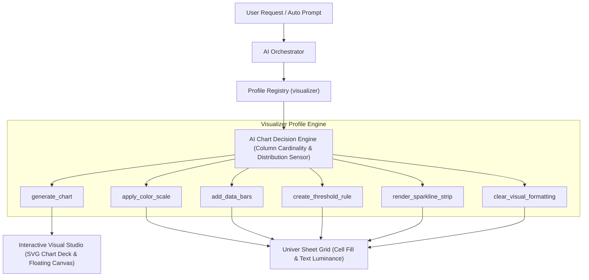

# Visualizer Profile & Interactive Visualization Engine Specification

## 1. Executive Overview
The **Visualizer Profile** (`visualizer`) is the 6th persona profile in Sortd. It provides an industrial-grade visual telemetry and charting engine that transforms raw numeric grids and aggregations into executive-ready visual representations.

The engine covers two tightly integrated visualization layers:
1. **Interactive Visual Studio (Full Graphs & Charts)**: Basic to advanced visualizations (Column, Horizontal Bar, Line, Area, Donut, Scatter, Bubble, Dual-Axis Combo, Waterfall, Treemap, Funnel, Radar, Pareto, Histogram, Box Plot) driven by an **AI Chart Recommendation Engine** or explicit user directives.
2. **In-Grid Visual Telemetry**: Reactive in-cell conditional formatting (2-color & 3-color quantile heatmaps, bipolar zero-axis data bars, status badges, and Unicode micro-sparklines) mapped directly onto spreadsheet cells without altering formulas, numbers, or structural layouts.

---

## 2. Architecture & Separation of Concerns

### Strict Non-Overlap Boundaries:
- **`architect`**: Governs static sheet hierarchy, typography, borders, table zebra striping, currency/date masks, and dashboard block layouts.
- **`analyst`**: Computes mathematical aggregations, pivots, regressions, and statistical cohorts.
- **`visualizer`**: Maps numeric and categorical values into visual representations (both external charts and dynamic in-cell formatting).

---

## 3. Tool Specifications

### Tool 1: `generate_chart`
* **Purpose**: Generates interactive, high-fidelity SVG visualizations from any workbook range.
* **Arguments**:
  - `range`: Target range (e.g., `'A1:C13'`).
  - `chartType`: `'auto' | 'column' | 'bar' | 'line' | 'area' | 'donut' | 'scatter' | 'bubble' | 'combo_dual_axis' | 'waterfall' | 'treemap' | 'funnel' | 'radar' | 'pareto' | 'histogram' | 'box_plot'`.
  - `xAxisColumn`: Column letter or header name for the X-axis / categories.
  - `yAxisColumns`: Array of column letters or header names for primary metrics.
  - `secondaryYAxisColumn`: Optional column for dual-axis combo charts (e.g. margin %).
  - `title`: Executive chart title.
  - `palette`: Color palette (`'slate_emerald' | 'monochrome_zinc' | 'ocean_blue' | 'diverging_bipolar'`).
  - `showDataLabels`: Boolean (renders value markers above bars/points).
  - `showLegend`: Boolean.

### Tool 2: `apply_color_scale`
* **Purpose**: Applies continuous or quantile color gradient heatmaps to a range.
* **Arguments**:
  - `range`: Target range.
  - `scaleType`: `'2_color' | '3_color' | 'quantile_percentile' | 'diverging_zero_centered'`.
  - `palette`: `'emerald_to_zinc' | 'slate_neutral' | 'red_amber_emerald' | 'blue_to_slate'`.
  - `clampOutliers`: Boolean (clips at P05/P95 to avoid scale distortion).

### Tool 3: `add_data_bars`
* **Purpose**: Injects in-cell proportional data bars with optional zero-axis centering.
* **Arguments**:
  - `range`: Target column range.
  - `barColor`: Primary positive bar color.
  - `negativeBarColor`: Optional negative bar color.
  - `axisPosition`: `'automatic' | 'cell_midpoint' | 'none'`.

### Tool 4: `create_threshold_rule`
* **Purpose**: In-cell condition alerts, status badges, and threshold styling.
* **Arguments**:
  - `range`: Target range.
  - `condition`: `'greater_than' | 'less_than' | 'between' | 'equal_to' | 'contains_text' | 'top_n_percent' | 'below_average'`.
  - `thresholdValue`: Number or string threshold.
  - `badgeStyle`: `'soft_alert_red' | 'soft_warning_amber' | 'soft_success_emerald' | 'subtle_highlight_zinc'`.

### Tool 5: `render_sparkline_strip`
* **Purpose**: Generates in-cell Unicode micro-sparklines (e.g. ` ▃▅▇█`) for multi-period rows (e.g. Q1..Q4).
* **Arguments**:
  - `sourceRange`: Continuous period columns.
  - `targetColumn`: Column to write sparkline trend characters into.
  - `sparklineType`: `'bars' | 'dots' | 'blocks'`.

### Tool 6: `clear_visual_formatting`
* **Purpose**: Granularly removes heatmaps, threshold rules, or charts without affecting sheet data or borders.
* **Arguments**:
  - `range`: Range to clear.
  - `target`: `'all' | 'color_scales' | 'threshold_rules' | 'data_bars'`.

---

## 4. UI / UX & Responsive Visual Studio
- **Chart Card in AI Workbench**: Whenever a chart is generated, an interactive SVG card with hover tooltips, metric legends, and download buttons appears directly in the conversation ledger.
- **Floating / Docked Visual Studio Tray**: A persistent visual dock in Sortd allowing users to view, expand, export, and toggle all generated charts alongside the live Univer spreadsheet.
- **WCAG High-Contrast Rules**: Automatic luminance thresholding ensuring text legibility over any interpolated background color.
